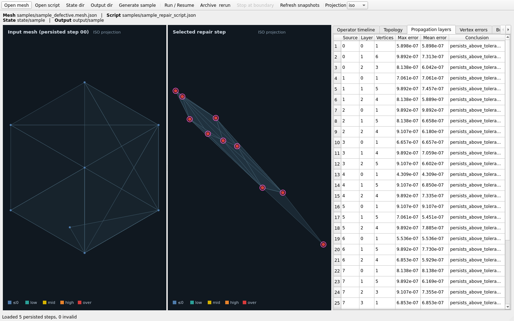

# Mesh Audit Workbench

本地桌面工作台，用于三角网格修复的可复现误差审计。程序从确定性样本出发，按 JSON 脚本执行孔洞三角化、退化面移除、法线重定向与拉普拉斯平滑；每一步同时维护 **int64 定点坐标**（权威结果）与 **float64 参考坐标**（仅对照），量化误差、沿拓扑邻接逐层追踪传播，并以原子快照支持中断续算和失效检测。

## 快速开始

目标运行环境：Windows + Python 3.11；也可在 Linux/WSL 运行。无需 GPU、Docker、外部模型或网络资源。

```powershell
py -3.11 -m venv .venv
.venv\Scripts\activate
python -m pip install -r requirements.txt
python -m pip install -e .
mesh-audit generate --directory samples
mesh-audit run --mesh samples/sample_defective.mesh.json --script samples/sample_repair_script.json --state state/sample --output output/sample
mesh-audit-gui
```

不安装包也可从仓库根目录运行：

```powershell
$env:PYTHONPATH="src"
python -m mesh_audit generate --directory samples
python -m mesh_audit run --mesh samples/sample_defective.mesh.json --script samples/sample_repair_script.json --state state/sample --output output/sample
python run_workbench.py
```

固定依赖版本见 `requirements.txt`：`numpy==2.2.6`、`PySide6==6.8.3`。

## 输入格式

网格支持 JSON 与三角 OBJ。JSON 网格示例：

```json
{
  "vertices": [[0, 0, 0], [1, 0, 0], [0, 1, 0]],
  "faces": [[0, 1, 2]]
}
```

修复脚本示例：

```json
{
  "schema_version": 1,
  "coordinate_tolerance": 1e-7,
  "area_tolerance": 1e-10,
  "fixed_scale": 1000000,
  "trace_radius": 5,
  "concurrency": 4,
  "memory_budget_nodes": 8192,
  "operators": [
    {"type": "hole_triangulation"},
    {"type": "remove_degenerate_faces"},
    {"type": "reorient_normals"},
    {"type": "laplacian_smooth", "iterations": 16, "lambda": 0.42}
  ]
}
```

校验规则：

- 顶点必须是有限三坐标数；面必须是三个整数索引；越界或负索引返回 `E_INDEX`。
- 非有限值、结构错误、未知字段、未知算子、非正容差/迭代参数返回 `E_SCHEMA`。
- 校验失败时 CLI 输出 JSON 错误，退出码 `2`，且不创建状态目录或输出文件。
- `fixed_scale` 是每单位坐标的整数刻度；`coordinate_tolerance` 仅用于误差判定，不会降低定点精度。

## 核心语义

### 定点与浮点双轨

- 初始坐标按 `fixed_scale` 四舍五入（ties away from zero）为 `int64`。
- 孔洞质心、Laplacian 平均值均先做整数运算；`lambda` 由脚本十进制串转换为精确有理数，最后只舍入一次。
- float64 使用同一算子公式单独计算，仅用于展示 `fixed - reference` 偏差。
- 报告中的包围盒、体积分子、曲率诊断、拓扑计数和最终审计结论均以定点网格为输入；float64 结果带 `reference_only` 标记。
- 每步还记录相对上一步的定点坐标最大增量，以及包围盒、面积、有符号体积和平均 Laplacian 曲率变化，用于区分“累计量化误差”与“算子自身几何改动”。

### 拓扑统计

每个步骤都构建并统计：

- 顶点到面、面到相邻面、顶点邻接；
- 非流形边、边界边、边界环/边界连通分量、开放边界链；
- 退化面、孤立顶点、方向冲突边；
- `Euler = V - E + F`，同时报告边界环数及流形情况下隐含亏格。

退化面定义为重复顶点索引或面积 `<= area_tolerance`。退化面不参与边关联、边界、方向冲突与面邻接统计；欧拉示性数使用全部唯一边、全部面与全部顶点。索引构建结果和独立的逐面重扫结果必须完全一致，报告中记录 `rescan_matches`。并行逐面退化扫描还会与索引扫描做掩码一致性检查。

### 传播追踪

每个算子记录直接受影响的顶点作为源：坐标改变、新顶点插入，或相关面被删除/翻转。对每个源在顶点邻接图上做确定性 BFS，记录 `source_vertex / operator_index / layer / vertices / max_abs_error / mean_abs_error`。层号与受影响集合由 BFS 生成，不从全网格事后差异反推。

逐层误差读数是该步骤的定点-参考坐标偏差；`source_only` 表示源外各层无偏差，`decays_below_tolerance` 表示某一层起低于容差，`persists_above_tolerance` 表示追踪半径内仍超差。最终仍以完整逐顶点误差表判定首次超差。

### 并发与内存预算

- 传播源和逐面退化判定使用有界 `ThreadPoolExecutor`。
- 内存预算单位是“同时驻留的顶点/面缓冲节点数”；任务按固定索引取得预算票号，超出预算的后续任务等待，不会降低数值精度。
- 单任务成本超过预算时返回 `E_BUDGET`，而不是静默降采样或放宽容差。
- 结果按源顶点/面索引归并；并发度变化只影响调度元数据，不改变诊断数值。

### 持久化与恢复

状态布局：

```text
state/sample/
  current/
    manifest.json
    step-0000.json   # 输入
    step-0001.json   # 算子 1 完成后
    ...
  archive/           # 版本变化或显式重启时归档，不覆盖
```

- 每个快照包含版本标识、步骤号、算子、双轨网格、诊断、误差表和传播记录。
- 先写同目录临时文件、`fsync`，再以 `os.replace` 原子替换；快照完整性由规范化 payload 的 SHA-256 校验。
- 版本标识由网格内容摘要、脚本规范化摘要共同生成。版本变化时整段现有运行先移到 `archive/`，不直接覆盖。
- 恢复只接受从 step 0 起连续、摘要有效且版本一致的快照。发现任一损坏/摘要不符快照时拒绝自动恢复并返回 `E_SNAPSHOT_INVALID`；`--restart` 会先归档再重跑。
- `SIGINT`/`SIGTERM` 只设置停止请求；当前算子完成并持久化后退出，约定退出码分别为 `130`/`143`。强制终止只会遗留在写临时文件，重启仅加载已持久化的有效快照。

## 桌面工作台

`python run_workbench.py` 或 `mesh-audit-gui` 打开界面：

- 左侧展示输入与所选步骤的等轴/顶视/前视二维投影；
- 顶点按该步骤定点-参考最大偏差热力着色；
- 时间线含 `[INVALID]` 标记，失效快照不会用于恢复或绘制网格；
- 选择算子或顶点可高亮直接传播源和受影响区域；
- 提供传播层表、逐顶点误差表、拓扑前后对照与业务码列表；
- 所有视图数据来自 `current/step-*.json` 和有效 `report.json`，不使用内存运行结果。

界面截图：`output/sample/workbench.png`。



## CLI 与退出码

```text
mesh-audit generate --directory samples
mesh-audit run --mesh MESH --script SCRIPT --state STATE --output OUTPUT [--restart]
mesh-audit inspect --state STATE
mesh-audit gui [--mesh ...] [--script ...] [--state ...] [--output ...]
```

- `0`：完成并写出 `report.json`
- `2`：`E_SCHEMA` / `E_INDEX` / `E_IO` / `E_BUDGET`
- `3`：`E_STATE` / `E_SNAPSHOT_INVALID`
- `130` / `143`：`SIGINT` / `SIGTERM` 在算子边界生效

输出报告包含：初始/最终统计、每步算子计数、完整逐顶点定点/参考差值、首次超差定位、传播层、业务码和定点权威结论。主要业务码：

- 错误：`E_SCHEMA`、`E_INDEX`、`E_IO`、`E_BUDGET`、`E_STATE`、`E_SNAPSHOT_INVALID`
- 缺陷/告警：`W_*_NONMANIFOLD_EDGE`、`W_*_BOUNDARY_EDGE`、`W_*_DEGENERATE_FACE`、`W_*_ISOLATED_VERTEX`、`W_*_ORIENTATION_CONFLICT`、`W_QUANTIZATION_TOLERANCE_EXCEEDED`
- 完成：`I_REPORT_COMPLETE`

## 样例实测

样例初始含 1 条非流形边、1 个边界环、1 个开放边界链、1 个退化面、1 个孤立顶点与 2 条方向冲突边。

| 指标 | 输入 | 最终 |
|---|---:|---:|
| 顶点 / 面 / 边 | 10 / 12 / 20 | 11 / 15 / 23 |
| 非流形边 | 1 | 1 |
| 边界边 / 边界环 | 6 / 1 | 2 / 0 |
| 退化面 | 1 | 0 |
| 孤立顶点 | 1 | 1 |
| 方向冲突边 | 2 | 0 |
| Euler 特征数 | 2 | 3 |
| 重扫一致 | true | true |

首次超过坐标容差：算子 `4`（Laplacian smooth），顶点 `0`，`5.89761087521623e-07 > 1e-07`。该步定点坐标最大改动为 `0.588019`，面积变化 `-6.284858`，有符号体积变化 `-0.9999993`，平均 Laplacian 曲率变化 `-0.642934`。定点结论为 `FAIL_FIXED_POINT_AUDIT`，float64 不参与最终判定。完整传播数据与逐顶点误差见 `output/sample/report.json`。

自动化验收与详细运行结果见 [VERIFICATION.md](VERIFICATION.md)。

## 代码结构

```text
src/mesh_audit/
  schema.py        输入解析与 E_SCHEMA/E_INDEX 校验
  mesh.py          双轨网格状态
  fixedpoint.py    int64 舍入、精确有理 Laplacian、逐顶点误差
  topology.py      邻接、缺陷统计、逐面重扫、几何量
  operators.py     四个确定性修复算子
  propagation.py   逐源 BFS 层追踪
  concurrency.py   有界有序内存预算线程池
  persistence.py   原子快照、摘要、恢复与归档
  engine.py        算子链、信号边界、报告构建
  diagnostics.py   并行诊断与业务码
  gui.py           PySide6 诊断工作台
  cli.py           命令行入口
  sample.py        确定性缺陷样本
tests/              20 个自动化验收用例
```

## 已知边界

- 孔洞使用单质心扇形三角化，仅填充闭合边界环；开放边界链会记录为跳过。
- 删除退化面不压缩顶点数组，因此原顶点可能保留为孤立点。
- 自相交网格可加载并参与现有统计，但当前任务指定的算子集不含自相交修复。
- 定点坐标必须落在 int64 内；超出时会返回明确错误而非回退到浮点。
- Windows 没有 POSIX `SIGKILL`；代码保证进程被强制结束时只留下已原子持久化的完整快照，重启行为与 Linux 一致。
